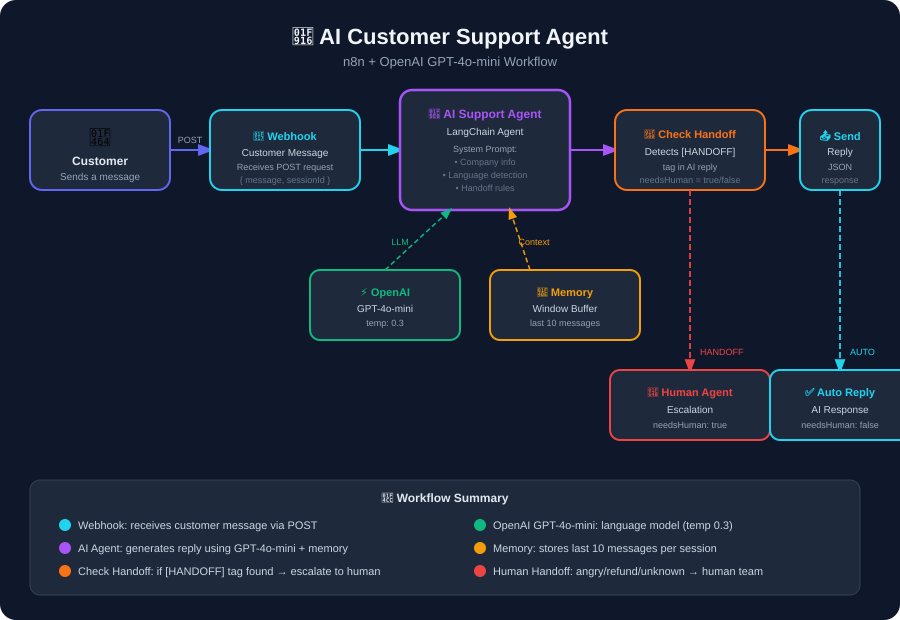

# 🤖 N8N AI Customer Support Agent

An intelligent, multilingual customer support automation workflow built with **n8n** and **OpenAI GPT-4o-mini**. It handles customer queries automatically and alerts the support team via Gmail when human intervention is needed.

---

## 🖼️ Workflow Diagram



---

## ✨ Features

- 🌐 **Multilingual** — replies in English, Urdu, or Roman Urdu (matches the customer's language)
- 🧠 **AI-Powered** — uses OpenAI GPT-4o-mini for smart, context-aware responses
- 💬 **Conversation Memory** — remembers the last 10 exchanges (Q&A pairs) per session
- 🔀 **Human Handoff Detection** — sets `needsHuman` flag when angry customers, refund requests, or unknown queries are detected
- 📧 **Gmail Alert** — automatically emails your support team when handoff is triggered
- ⚡ **Webhook-based** — easy to connect with WhatsApp, Telegram, or any frontend
- 🛡️ **Safe by design** — never asks for passwords, card numbers, or OTPs

---

## 🗂️ Workflow Overview

```
Customer Message (Webhook)
        ↓
  AI Support Agent  ←──  OpenAI GPT-4o-mini (temp 0.3)
        ↑                 Conversation Memory (10 exchanges)
        ↓
  Check Handoff  →  sets needsHuman flag (true/false)
        ↓
   Send Reply  →  always returns { reply, needsHuman } to caller
        ↓
  Needs Human? (IF node)
   ↙            ↘
true             false
  ↓                ↓
Alert Team       (end)
(Gmail)
```

| Node | Type | Description |
|------|------|-------------|
| **Customer Message (Webhook)** | Webhook | Receives POST `{ message, sessionId }` |
| **AI Support Agent** | LangChain Agent | Generates reply with company system prompt |
| **OpenAI Chat Model** | GPT-4o-mini | Language model at temperature 0.3 |
| **Conversation Memory** | Window Buffer | Stores last 10 Q&A exchanges per session |
| **Check Handoff** | Set node | Sets `needsHuman` flag — no branching here |
| **Send Reply** | Respond to Webhook | Always returns JSON to caller first |
| **Needs Human?** | IF node | Branches after reply is sent |
| **Alert Team (Gmail)** | Gmail | Emails support team with session details |

---

## 🚀 Setup Guide

### 1. Import the Workflow
1. Open your n8n instance
2. Click **Import** → upload `Ai customer support agent .json`

### 2. Add OpenAI Credentials
1. Open the **OpenAI Chat Model** node
2. Add your OpenAI API key under credentials

### 3. Add Gmail Credentials
1. Open the **Alert Team (Gmail)** node
2. Connect your Gmail account via OAuth2
3. Set the `sendTo` field to your support team email (e.g. `support-team@yourstore.com`)

### 4. Customize Company Info
Edit the **System Message** inside the **AI Support Agent** node with your own:
- Working hours
- Delivery & return policy
- Payment methods
- Support email & phone number

### 5. Activate the Workflow
Click **Activate** in the top-right corner of n8n.

---

## 🧪 Test It

### Normal query
```bash
curl -X POST <YOUR_WEBHOOK_URL> \
  -H "Content-Type: application/json" \
  -d '{"sessionId": "user123", "message": "How long does delivery take?"}'
```

**Response:**
```json
{
  "reply": "Delivery usually takes 3 to 5 working days. Orders above 2000 PKR get free delivery!",
  "needsHuman": false
}
```

### Handoff trigger
```bash
curl -X POST <YOUR_WEBHOOK_URL> \
  -H "Content-Type: application/json" \
  -d '{"sessionId": "user456", "message": "I want a refund now!"}'
```

**Response:**
```json
{
  "reply": "I understand your concern. Let me connect you with our support team right away.",
  "needsHuman": true
}
```
> Gmail alert is sent to your support team automatically.

---

## 📋 API Reference

### Request Body

| Field | Type | Required | Description |
|-------|------|----------|-------------|
| `sessionId` | string | ✅ | Unique ID per user/conversation |
| `message` | string | ✅ | Customer's message |

### Response Body

| Field | Type | Description |
|-------|------|-------------|
| `reply` | string | AI-generated response (HANDOFF tag removed) |
| `needsHuman` | boolean | `true` if Gmail alert was triggered |

---

## 📧 Gmail Alert Email Format

When `needsHuman` is `true`, the support team receives:

```
Subject: 🚨 Customer Handoff Required — Session <sessionId>

Customer Needs Human Support

Session ID: user456
Customer Message: I want a refund now!
AI Reply Sent: I understand your concern. Let me connect you with our support team...

Please follow up with this customer as soon as possible.
```

---

## 🔧 Customization Ideas

- 💬 Replace Webhook trigger with a **WhatsApp** or **Telegram** node
- 📢 Swap Gmail alert with a **Slack** message to a `#support-alerts` channel
- 🗄️ Replace memory buffer with **Redis** or **Postgres** for persistent memory
- 📊 Log all conversations to **Google Sheets** or a database
- 🔔 Add **multiple alert channels** (Gmail + Slack simultaneously)

---

## 🛠️ Tech Stack

- [n8n](https://n8n.io/) — Workflow automation
- [OpenAI GPT-4o-mini](https://platform.openai.com/) — Language model
- [LangChain nodes for n8n](https://docs.n8n.io/integrations/builtin/cluster-nodes/root-nodes/n8n-nodes-langchain.agent/) — AI agent framework
- Gmail OAuth2 — Human handoff alert

---

## 📄 License

MIT License — free to use, modify, and distribute.

---

> Built with ❤️ using n8n + OpenAI
